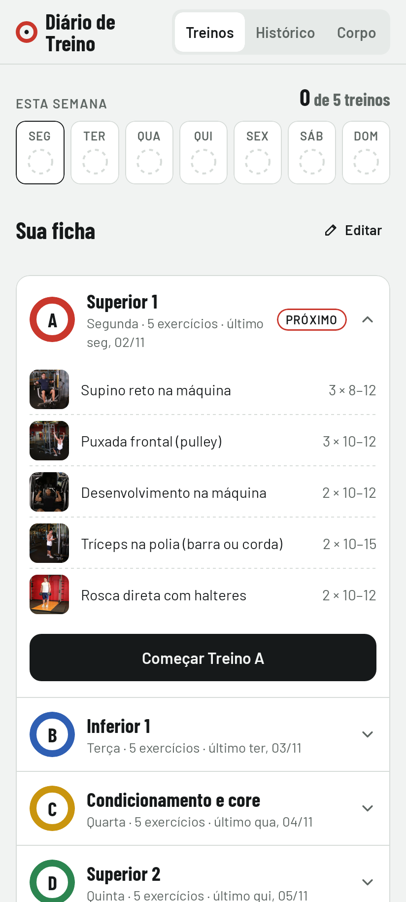
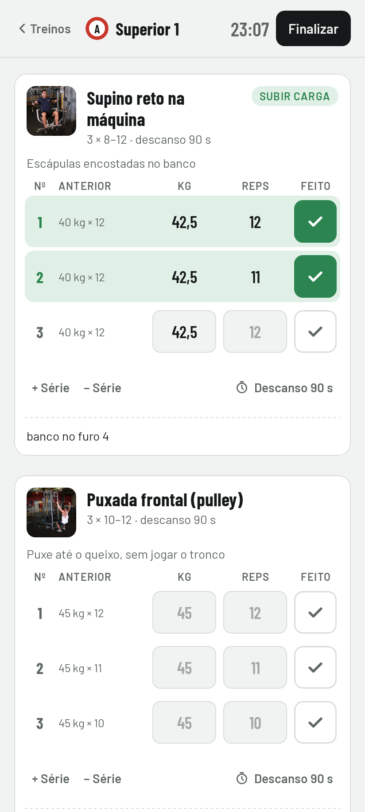
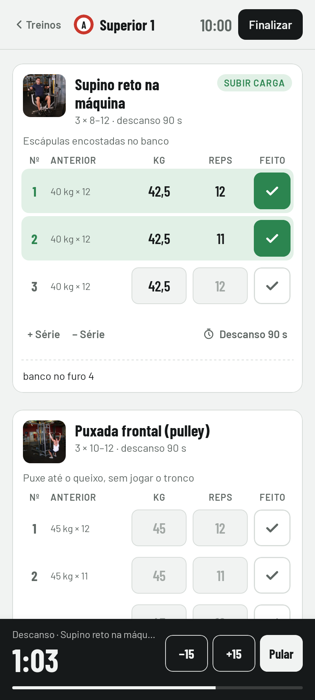
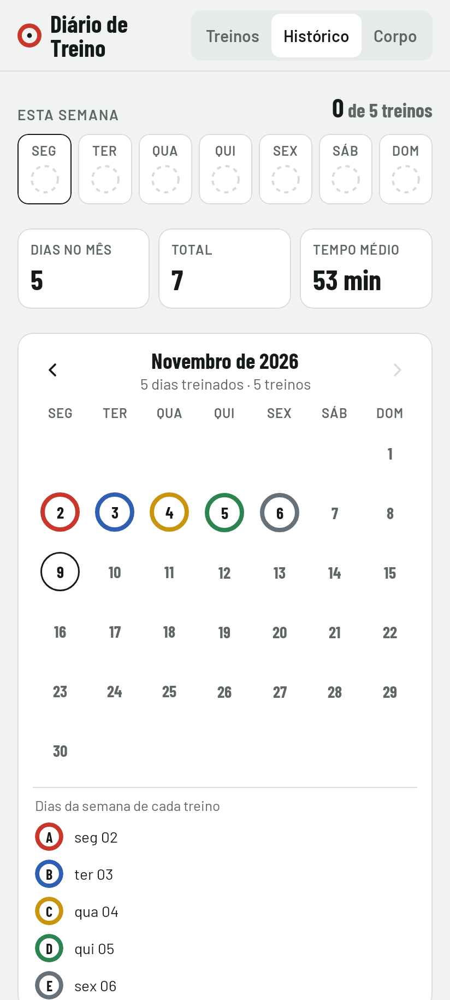
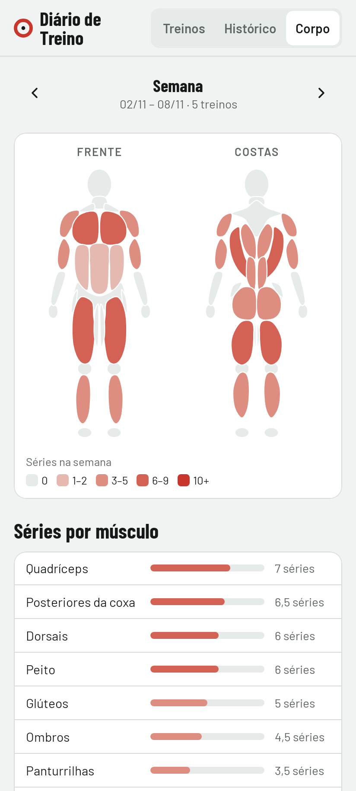
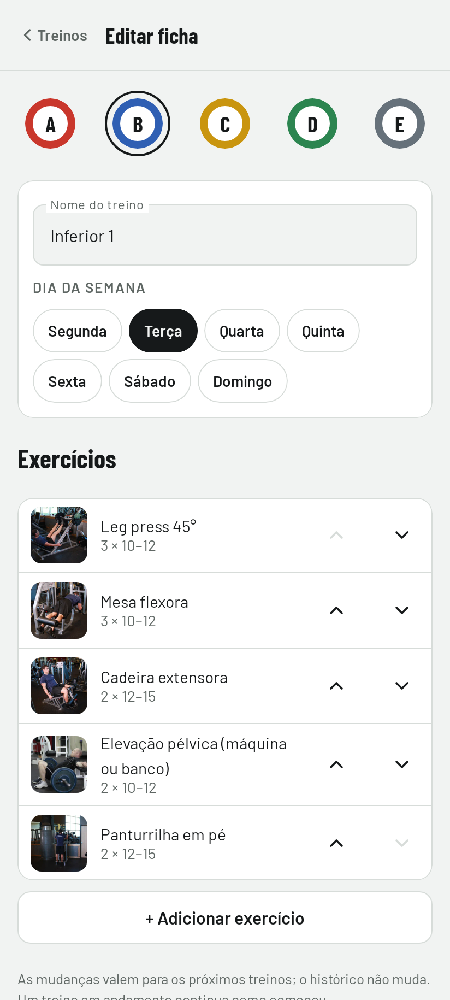
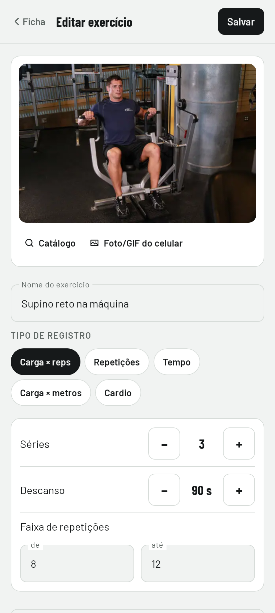

# Sliced · Diário de Treino

App Android nativo para registrar treinos de musculação: carga e repetições por série, timer de descanso que avisa com a tela apagada, fotos de cada movimento, histórico com a evolução de cada exercício e um mapa do corpo com os músculos treinados na semana. Funciona 100% offline e já vem com a ficha de treino (divisão A–E) carregada, que você pode editar.

<p>
  
  
  
  
</p>
<p>
  
  
  
</p>

## Funcionalidades

- **Treinos**: semana atual (Seg–Dom) com o treino feito em cada dia, a ficha A–E com o **próximo** treino já aberto. Tocar num exercício mostra a foto do movimento, os músculos e a dica.
- **Editar ficha**: nome e dia de cada treino; adicionar, remover e reordenar exercícios; mudar séries, faixa de reps, descanso, tipo, dica e músculos. Renomear não quebra o histórico (as séries ficam ligadas ao exercício por um id, não pelo nome).
- **Fotos dos movimentos**: 76 exercícios com fotos de início e fim do movimento, que se alternam como um GIF. Dá para trocar pela sua própria foto ou GIF da galeria.
- **Treino em andamento**: tabela de séries com o que você fez da **última vez**; ao tocar ✓, os campos vazios são preenchidos com os valores anteriores e o descanso começa. A etiqueta **Subir carga** aparece quando todas as séries da última vez bateram o topo da faixa (dupla progressão).
- **Timer de descanso**: barra fixa com −15 / +15 / Pular. Com o celular bloqueado, uma notificação mostra a contagem e toca/vibra no fim.
- **Nada se perde**: o treino em andamento é salvo a cada toque e sobrevive a fechar o app ou reiniciar o celular.
- **Histórico**: dias treinados no mês, calendário com a anilha do treino em cada dia e os dias da semana em que cada treino foi feito; gráfico da maior carga por treino e detalhes de cada sessão.
- **Corpo**: boneco de frente e de costas que vai sendo pintado conforme você treina cada músculo na semana (cada série conta 1 para os músculos principais e ½ para os secundários), com a lista de séries por músculo e as semanas anteriores.
- Tema claro e escuro, textos em português, alvos de toque de 48 dp.

## Instalar no celular

1. Baixe o APK no artefato `diario-de-treino-apk` do GitHub Actions ou gere com `./gradlew :app:assembleRelease` (sai em `app/build/outputs/apk/release/`).
2. No celular, abra o arquivo e permita **Instalar apps desconhecidos** para o app que abriu o APK (Arquivos, Chrome...).
3. Na primeira vez que começar um treino, aceite a permissão de **notificações**: é ela que avisa o fim do descanso com a tela apagada.

O APK é assinado com a chave `app/debug.keystore`, que está no repositório. Assim, qualquer build novo instala **por cima** do anterior sem apagar o histórico. Essa chave não é secreta; para publicar na Play Store, use outra.

## Arquitetura

```
app/src/main/java/com/pedrohmsouza/sliced/
├── model/        Ficha (Treino, PlannedExercise), sessões e rascunho. Kotlin puro.
├── domain/       Regras de negócio (WorkoutRules) e formatação pt-BR (Fmt). Funções puras.
├── data/         Repositórios (interfaces) + Room (entidades, DAOs, banco).
├── timer/        RestTimer, alarme exato, notificações, som e vibração.
├── ui/           Telas Compose + ViewModels (home, workout, history), tema e componentes.
├── AppContainer  Injeção de dependência manual.
└── SlicedApp     Application: cria o container e avisa o timer quando o app vai para o fundo.
```

**MVVM com fluxo unidirecional.** Cada tela tem um `ViewModel` que expõe um único `StateFlow<UiState>`. A tela só desenha o estado e chama funções do ViewModel; ela não sabe de onde vêm os dados. O ViewModel sobrevive à rotação da tela.

**Regras em funções puras.** "Próximo treino", "Anterior", "Subir carga" etc. ficam em `WorkoutRules`: recebem dados e devolvem dados, sem Android, sem banco e sem relógio implícito. Por isso são testadas com JUnit simples (`WorkoutRulesTest`).

**Repositórios como interfaces.** Os ViewModels conhecem `SessionRepository`, `DraftRepository` e `ProgramRepository`, nunca o Room direto. Os testes usam versões em memória; uma sincronização na nuvem no futuro entraria aqui sem mexer nas telas. A ficha é lida como `ProgramSource`: sem edição salva, é a inicial (`StaticProgram`); depois de editada, vem do banco.

**Room.** O histórico fica em três tabelas: `sessions` → `session_exercises` → `session_sets`, com `ON DELETE CASCADE`. Uma sessão é gravada numa transação: ou entra inteira, ou não entra. O treino em andamento é uma linha só com o estado em JSON. Ele muda a cada toque e só vira histórico ao finalizar, então não vale ter tabelas próprias. A ficha editada segue a mesma ideia (tabela `program`, uma linha em JSON). O esquema de cada versão fica em `app/schemas/`; a versão 2 só acrescentou a tabela da ficha, com migração automática (`AutoMigration`) testada a partir de um banco da versão 1 com histórico.

**Fotos.** O catálogo (`ExerciseLibrary`) vem do [free-exercise-db](https://github.com/yuhonas/free-exercise-db), de domínio público (Unlicense): duas fotos por exercício em `assets/exercises/`, convertidas para WebP (~2,7 MB no total), e os músculos de cada um. Fotos e GIFs escolhidos na galeria são copiados para a pasta do app, porque o endereço que o seletor de fotos devolve é temporário. O Coil carrega as imagens e anima os GIFs; como só lê arquivos locais, o app continua sem permissão de internet.

**Injeção de dependência manual (sem Hilt).** O app tem um banco, dois repositórios e um timer, então `AppContainer` monta tudo à mão e deixa explícito quem cria o quê. O Hilt faz o mesmo gerando código a partir de anotações, e compensa quando o grafo cresce. Migrar é direto: cada `val` do container vira um `@Provides`.

**Timer de descanso.** O timer guarda o *horário de término*, não um contador. Um contador atrasa quando o Android suspende o app; o horário de término está sempre certo. Com a tela apagada:
- um alarme exato (`AlarmManager.setAlarmClock`) acorda o app no fim, mesmo em Doze e com a economia de bateria da Samsung. Efeito colateral: o ícone de alarme aparece na barra de status durante o descanso;
- uma notificação mostra a contagem regressiva, desenhada pelo próprio sistema (`setChronometerCountDown`), com botões +15 s e Pular. No Android 16 ela pede para virar *Live Update* (Now Bar no One UI 8);
- no fim, uma notificação de alta prioridade toca e vibra. Com o app aberto, o bipe e a vibração saem direto.

**Single module.** Para um app deste tamanho, um módulo `:app` organizado por pacotes é mais simples de entender e compila rápido. A separação por pacotes já deixa o caminho aberto para módulos (`core:data`, `feature:workout`...) se o projeto crescer.

## Testes

```bash
./gradlew :app:testDebugUnitTest
```

Todos os testes rodam na JVM, sem emulador:

- `WorkoutRulesTest`, `FmtTest`: cada regra de negócio da especificação, incluindo o calendário do mês.
- `ProgramRulesTest`, `BodyRulesTest`: edição da ficha e contagem de séries por músculo.
- `ExerciseEditViewModelTest`: criar, editar e remover exercícios da ficha.
- `ProgramRepositoryTest`: a ficha no Room e a migração do banco 1 → 2 sem perder o histórico.
- `RestTimerTest`: o timer com tempo virtual (fim, −15/+15, alarme duplicado, segundo plano).
- `WorkoutViewModelTest`: o fluxo marcar série → salvar → limpar rascunho.
- `RoomRepositoriesTest`: o Room de verdade (SQLite em memória via Robolectric).
- `*ScreenshotTest`: renderizam as telas com Roborazzi. Para gerar as imagens em `app/screenshots/`:

```bash
./gradlew :app:testDebugUnitTest -Proborazzi.test.record=true
```

## Stack

Kotlin · Jetpack Compose + Material 3 · Navigation Compose (rotas type-safe) · Room · Coil 3 · kotlinx.serialization · Coroutines/Flow · AGP 9 · minSdk 26 · targetSdk 36 (Android 16) · JUnit + Robolectric + Roborazzi.

## Licenças

Fontes Barlow e Barlow Condensed: SIL Open Font License (`docs/barlow-OFL.txt`).
